<p align="center">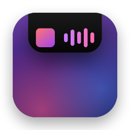</p>

# Notch

Dynamic Island สำหรับ MacBook ที่มี notch — เขียนด้วย Rust ล้วน (AppKit ผ่าน [`objc2`](https://github.com/madsmtm/objc2))

ชี้เมาส์ที่ notch แล้วมันจะเด้ง, คลิกเพื่อขยาย, คลิกที่อื่นเพื่อหุบ

<p align="center">
  <br>
  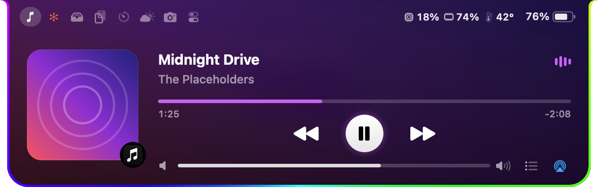
</p>

## ภาพตัวอย่าง

| | |
|---|---|
| 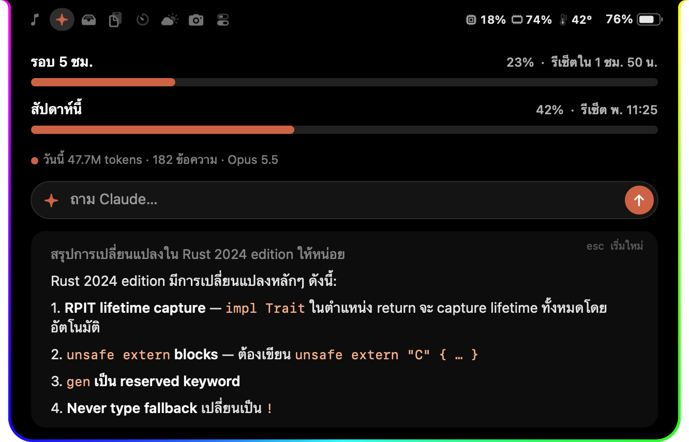 | 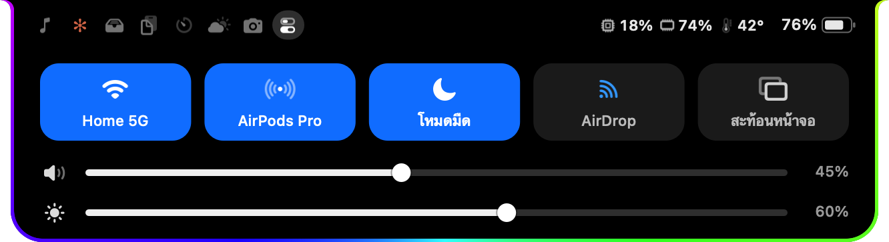 |
| **✦ Claude** — % การใช้งาน + ถาม Claude | **⚙ ควบคุม** — Wi-Fi, Bluetooth, โหมดมืด, AirDrop |
| 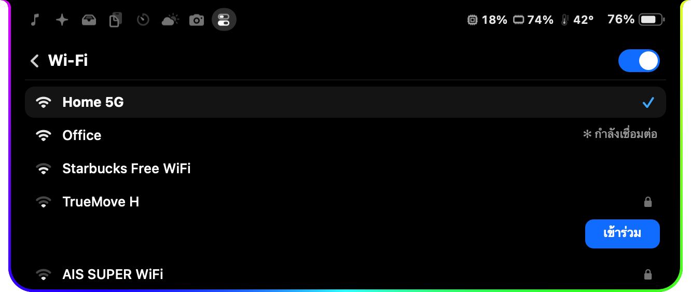 | 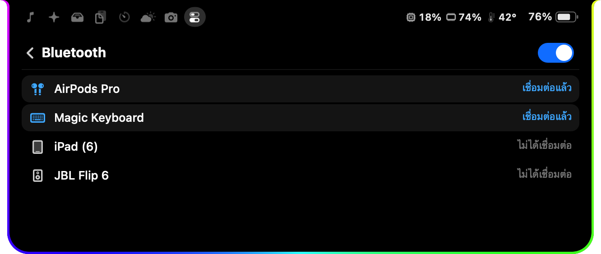 |
| **รายชื่อ Wi-Fi** ใน notch (ดับเบิลคลิก Wi-Fi) | **อุปกรณ์ Bluetooth** (ดับเบิลคลิก Bluetooth) |
| 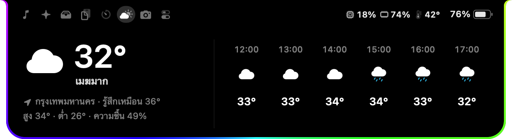 | 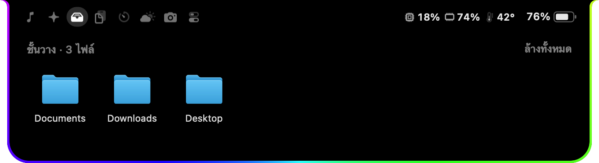 |
| **☁ อากาศ** | **🗃 ชั้นวาง** — พักไฟล์ไว้แล้วลากออก |
| 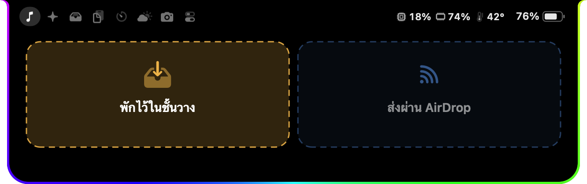 | 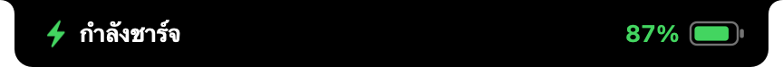 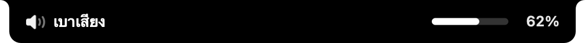 |
| **ลากไฟล์มาที่ notch** — พักไว้ หรือ AirDrop | **แถบแจ้งเตือน** — ชาร์จ, เสียง/ความสว่าง |
| 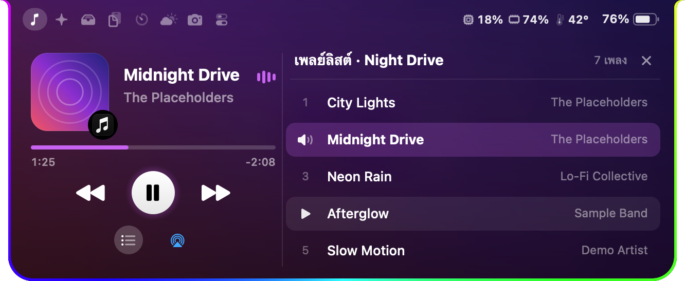 | 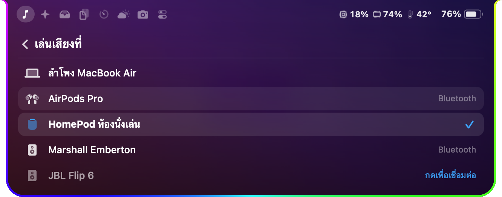 |
| **☰ เพลย์ลิสต์ / คิว** — แบ่งครึ่ง notch, กดเพื่อเล่น | **เลือกลำโพง** — Mac, หูฟัง, Bluetooth, AirPlay |
| 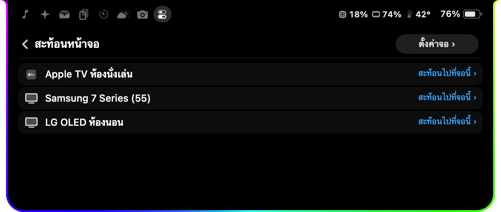 | 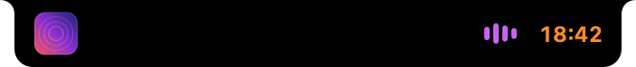 |
| **สะท้อนหน้าจอ** — ทีวี / Apple TV ในเครือข่าย | **นับถอยหลังข้าง notch** ตอนหดอยู่ |

<p align="center">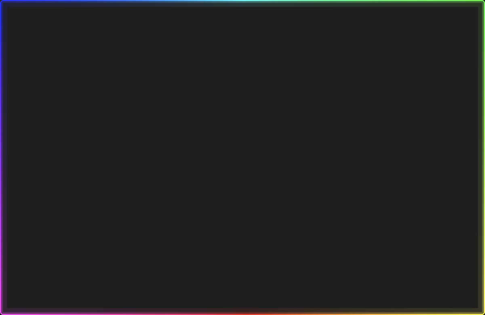<br><b>ขอบไฟ</b> — รอบ notch หรือ<b>ขอบจอทั้งจอ</b> ตอนขยาย (รุ้ง RGB / สีปกเพลง / สีที่เลือก)</p>
| 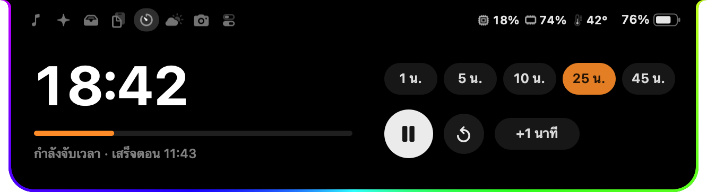 | 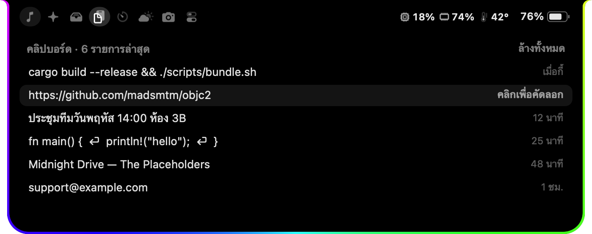 |
| **⏱ ตัวจับเวลา** — นับถอยหลังโชว์ข้าง notch แม้ตอนหด | **📋 คลิปบอร์ด** — ข้อความที่คัดลอกล่าสุด คลิกเพื่อคัดลอกอีกครั้ง |

> ภาพสร้างด้วย `NOTCH_DEMO=1 notch --snapshot docs/screenshots` (เพลง/ตัวเลขสมมติ)

## ทำอะไรได้บ้าง

| แท็บ | |
|---|---|
| ♪ **เพลง** | Spotify · Apple Music · YouTube / YouTube Music (Chrome, Brave, Edge, Safari) — ปก, ชื่อเพลง, เล่น/ข้าม, เลื่อนเวลา, ปรับเสียงของตัวเล่น, พื้นหลังปกเบลอ, แท่ง waveform เด้งตามเสียงจริง, **เลือกเพลงจากเพลย์ลิสต์/คิว** (Apple Music, YouTube, YouTube Music), **เลือกลำโพง** (ลำโพง Mac, หูฟัง, Bluetooth, AirPlay) |
| ✦ **Claude** | % การใช้งานรอบ 5 ชม. และรายสัปดาห์ (เหมือน `/usage`), สรุปวันนี้, **ถาม Claude** ได้จากใน notch (ใช้ Claude Code ที่ติดตั้งอยู่) |
| 🗃 **ชั้นวาง** | ลากไฟล์มาพักไว้ แล้วค่อยลากออกไปวางที่อื่น |
| 📋 **คลิปบอร์ด** | 7 ข้อความล่าสุดที่คัดลอก คลิกเพื่อคัดลอกอีกครั้ง (เก็บในหน่วยความจำเท่านั้น, ข้ามรหัสผ่านจากตัวจัดการรหัสผ่าน) |
| ⏱ **ตัวจับเวลา** | 1 / 5 / 10 / 25 (Pomodoro) / 45 นาที, หยุดชั่วคราว, +1 นาที — นับถอยหลังข้าง notch และเด้งแจ้ง + เสียงตอนหมดเวลา |
| ☁ **อากาศ** | อุณหภูมิ, สภาพอากาศ, พยากรณ์รายชั่วโมง (Open-Meteo) |
| 📷 **กล้อง** | กระจกส่องหน้าจากกล้องหน้า |
| ⚙ **ควบคุม** | Wi-Fi / Bluetooth (ดับเบิลคลิกเพื่อดูรายชื่อและเชื่อมต่อใน notch), โหมดมืด, AirDrop, สะท้อนหน้าจอ (รายชื่อทีวี / Apple TV ในเครือข่าย), เสียง, ความสว่าง |

และเวลา notch หดอยู่:

- ตัวหมุน ✻ ตอน **Claude Code กำลังทำงาน** (ผ่าน hooks), ✋ ตอนรอคุณ, ✓ ตอนเสร็จ
- แถบ **กำลังชาร์จ**, **แบตเหลือน้อย**, **ปรับเสียง/ความสว่าง** แบบ iPhone
- ไอคอนกล้องสีเขียวตอนกล้องเปิด
- ลากไฟล์มาที่ notch → พักไว้ในชั้นวาง หรือส่ง AirDrop
- มุมขวาบนตอนขยาย: CPU · RAM · อุณหภูมิ · แบต

## ติดตั้ง

ต้องมี: MacBook ที่มี notch (เครื่องอื่นจะวาด notch ปลอมให้), macOS 14.2+, [Rust](https://rustup.rs)

```sh
git clone <repo> notch && cd notch
./scripts/install.sh
```

ตัวติดตั้งจะ build แล้วลง `/Applications/Notch.app`, ตั้ง hooks ของ Claude Code (ถ้ามี), ตั้งให้เปิดเองตอนเข้าเครื่อง แล้วเปิดแอปให้ — รันซ้ำเพื่ออัปเดต

ถอนการติดตั้ง: `./scripts/uninstall.sh` (ใส่ `--purge` เพื่อลบข้อมูลใน `~/.claude/notch` ด้วย)

## ตั้งค่า

<p align="center">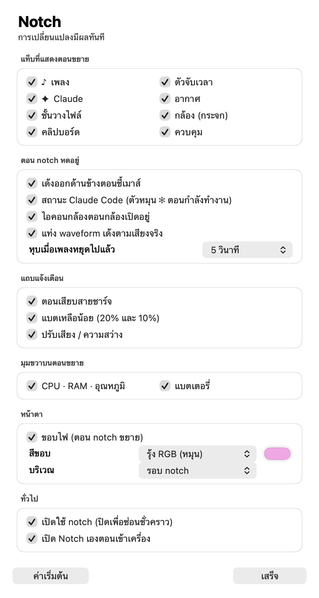</p>

คลิกขวาที่ notch → **ตั้งค่า Notch…** หรือเปิด **Notch** จาก Launchpad / Spotlight อีกครั้งตอนที่มันรันอยู่
เลือกแท็บที่จะแสดง, เปิด/ปิดแถบแจ้งเตือน, การเด้งตอนชี้เมาส์, waveform, CPU/RAM, เวลาก่อนหุบ และการเปิดเองตอนเข้าเครื่อง — มีผลทันที (เก็บไว้ที่ `~/.claude/notch/config.json`)

ซ่อน notch ชั่วคราว: ตั้งค่า → **เปิดใช้ notch**; ปิดโปรแกรมจริงๆ: คลิกขวาที่ notch → **ออกจาก Notch** (⌘Q ในหน้าตั้งค่าแค่ปิดหน้าต่าง)

## สิทธิ์ที่ macOS จะถาม (ใช้เมื่อเปิดฟีเจอร์นั้นเท่านั้น)

| สิทธิ์ | ใช้กับ |
|---|---|
| Automation (Spotify / Music / Chrome / Safari) | อ่านเพลงที่เล่นและควบคุม |
| Location | ชื่อ Wi-Fi และสภาพอากาศ |
| Camera | แท็บกล้อง |
| System Audio Recording | แท่ง waveform เด้งตามเสียง (ไม่บันทึกเสียง) |
| Accessibility | ปุ่มเพลงสำหรับ YouTube ที่ไม่ได้เปิด JavaScript (ส่ง media key) |
| Keychain: "Claude Code-credentials" | % การใช้งาน Claude — token ถูกส่งไป `api.anthropic.com` เท่านั้น |

YouTube แบบเต็ม (เวลา, เลื่อนเวลา, เสียง) ต้องเปิด Chrome → **View → Developer → Allow JavaScript from Apple Events**

## ความเป็นส่วนตัว

- ทุกอย่างทำงานในเครื่อง ยกเว้น: สภาพอากาศ (พิกัดปัดเศษ ~1 กม. ไปที่ Open-Meteo), ปกเพลง/ข้อมูลวิดีโอจาก YouTube, และ % การใช้งาน Claude (ไปที่ Anthropic)
- ไม่มี analytics ไม่มีการเก็บ log

## หมายเหตุ

บางอย่างใช้ API ภายในของ macOS ที่ Apple ไม่ได้รับประกัน (Bluetooth, ความสว่าง, อุณหภูมิ) และ endpoint การใช้งานของ Claude ก็ไม่ใช่ API ทางการ — ถ้าเปลี่ยนในอนาคต ส่วนนั้นจะหายไปแต่แอปยังทำงานได้

## โครงสร้าง

```
src/
  main.rs        UI ทั้งหมด (NSPanel + NSView วาดเอง)
  settings.rs    หน้าต่างตั้งค่า
  config.rs      ค่าตั้งค่า ~/.claude/notch/config.json
  player.rs      Spotify / Music / YouTube ผ่าน AppleScript
  status.rs      สถานะ Claude Code จาก hooks
  claude.rs      สรุป token จาก log ของ Claude Code
  claude_api.rs  % การใช้งานจริง
  ask.rs         ถาม Claude (`claude -p`)
  markdown.rs    แสดงคำตอบแบบ Markdown
  clip.rs        ประวัติคลิปบอร์ด
  airplay.rs     สะท้อนหน้าจอ
  tap.rs         Core Audio process tap → แท่ง waveform
  nets.rs        รายชื่อ Wi-Fi / Bluetooth
  controls.rs    Wi-Fi / Bluetooth / เสียง / ความสว่าง / โหมดมืด
  weather.rs     Open-Meteo
  sysinfo.rs     CPU / RAM / อุณหภูมิ
  …
scripts/
  bundle.sh      สร้าง dist/Notch.app
  install.sh     ติดตั้งครั้งเดียวจบ
  uninstall.sh
```

`notch --snapshot <dir>` เรนเดอร์ทุกหน้าเป็น PNG (ใช้ตรวจ UI โดยไม่ต้องแคปหน้าจอ), `notch --dump` พิมพ์สถานะที่ตรวจเจอ
