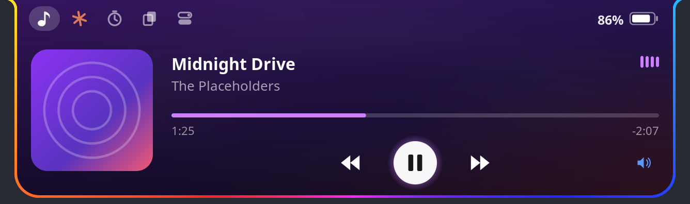
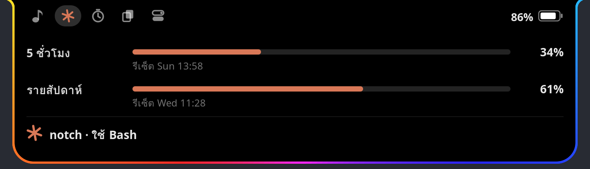
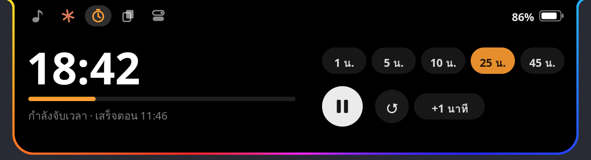
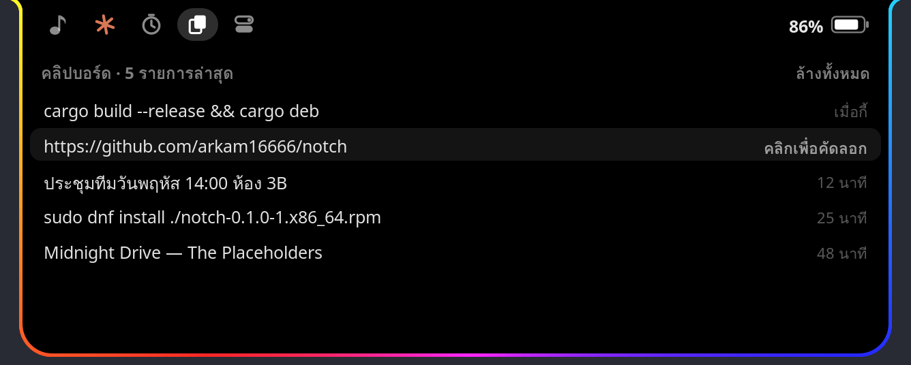
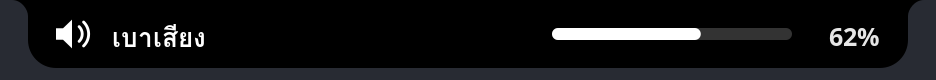
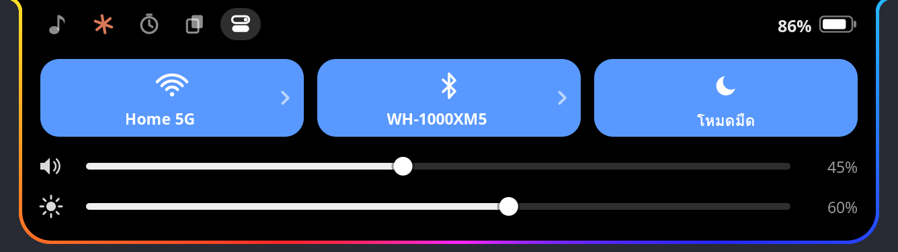
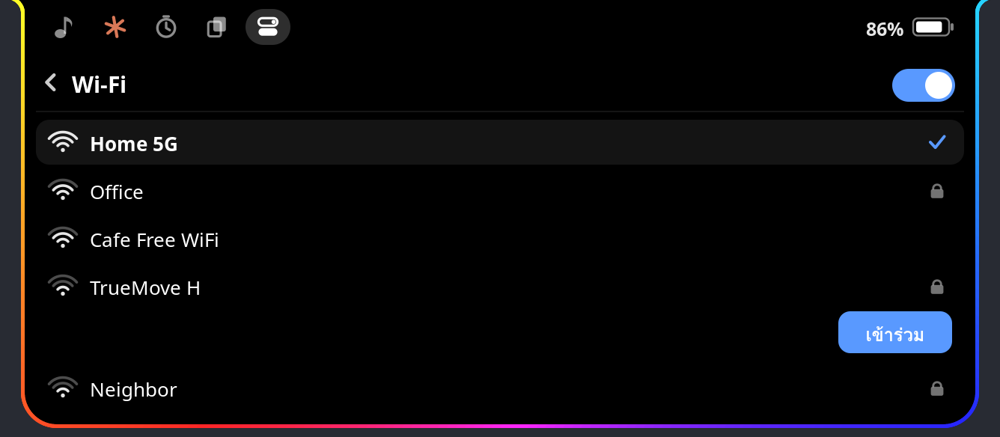
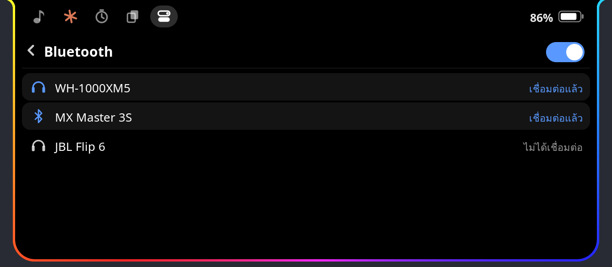
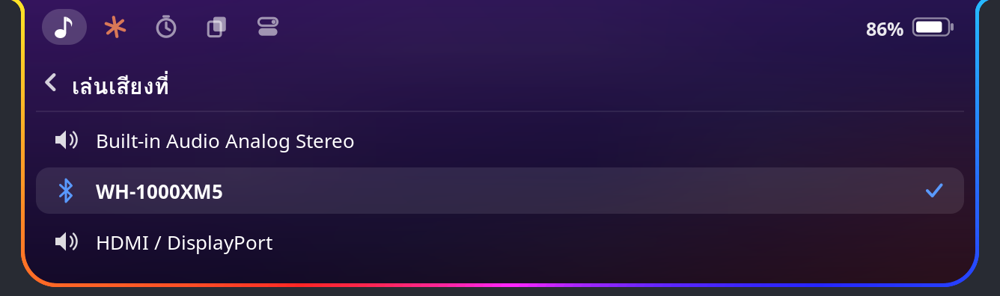
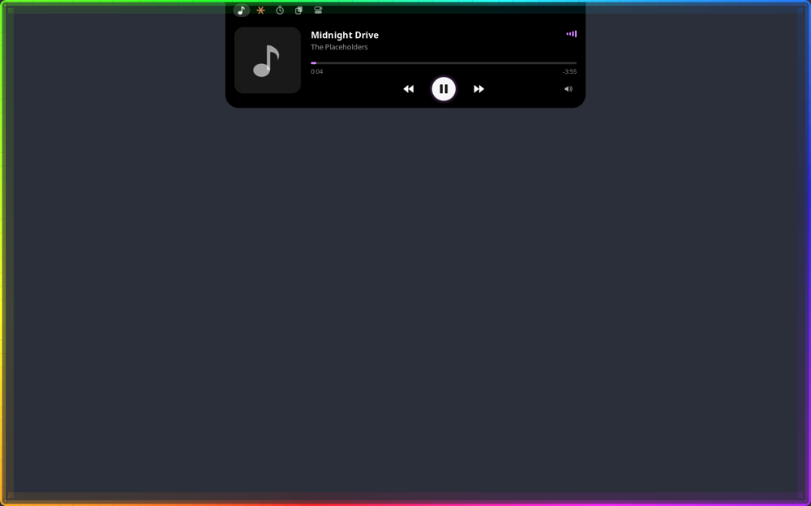

# Notch for Linux

Dynamic Island ที่ขอบบนกลางจอ สำหรับ Linux ทุกตระกูล (Debian/Ubuntu, Fedora/RHEL, Arch, openSUSE …)

<p align="center">
  <br>
  
</p>

| | |
|---|---|
|  |  |
|  |  |
|  |  |
|  |  |

<p align="center"><br>ไฟขอบจอทั้งจอ (Wayland จริง)</p>

## ทำอะไรได้

- **♪ เพลง** — ตัวเล่นไหนก็ได้ที่รองรับ MPRIS: Spotify, YouTube ใน Firefox/Chrome, VLC, mpv, Rhythmbox… (ปก, ชื่อเพลง, เล่น/หยุด/ข้าม, เลื่อนเวลา) + **เลือกลำโพง** (ลำโพงในเครื่อง, หูฟัง, Bluetooth, HDMI)
- **⚙ ควบคุม** — Wi-Fi (ชื่อเครือข่าย, รายชื่อ, ใส่รหัสผ่าน), Bluetooth (อุปกรณ์ที่จับคู่, เชื่อม/ตัด), โหมดมืด, เสียง, ความสว่าง
- **✻ Claude** — % การใช้งาน 5 ชม. / รายสัปดาห์ และสถานะ Claude Code (ตัวหมุนตอนทำงาน)
- **⏱ ตัวจับเวลา** — นับถอยหลังโชว์ข้างเกาะตอนหดอยู่
- **📋 คลิปบอร์ด** — 7 ข้อความล่าสุด คลิกเพื่อคัดลอกอีกครั้ง (หน่วยความจำเท่านั้น)
- **แถบแจ้งเตือน** — เพิ่ม/เบาเสียง, ความสว่าง, เสียบชาร์จ, แบตเหลือน้อย, หมดเวลา
- **ขอบไฟ** ตอนขยาย — รอบเกาะ หรือขอบจอทั้งจอ (Wayland), รุ้ง RGB / ตามสีปกเพลง / สีที่เลือก
- **หน้าตั้งค่า** — คลิกขวาที่เกาะ → ตั้งค่า, หรือ `notch --settings` (ไฟล์เดียวกับเวอร์ชัน Mac: `~/.claude/notch/config.json`)

ชี้เมาส์ = เกาะเด้ง · คลิก = ขยาย · เอาเมาส์ออก = หุบ · คลิกขวา = ตั้งค่า / ออก

Wi-Fi ใช้ `nmcli` (NetworkManager), Bluetooth ใช้ `bluetoothctl` (BlueZ), ลำโพง/เสียงใช้ `pactl` — มีในเกือบทุก distro อยู่แล้ว

## ใช้กับหน้าจอแบบไหนได้

| หน้าจอ | วิธี |
|---|---|
| KDE Plasma, Hyprland, Sway, river, labwc … (Wayland) | layer-shell — ลอยอยู่บนสุดของจอ |
| X11 (XFCE, Cinnamon, MATE, i3 …) | หน้าต่างแบบ dock อยู่บนสุดทุก workspace |
| GNOME (Wayland) | ไม่มี layer-shell → เปิดผ่าน XWayland ให้อัตโนมัติ และลอยเป็นแคปซูล**ใต้แถบบน**ของ GNOME (แถบบนของ GNOME อยู่เหนือทุกหน้าต่างเสมอ) |

<p align="center"><br>GNOME 48 จริง (Wayland + XWayland)</p>

ไฟขอบจอทั้งจอใช้ได้ทั้ง Wayland (layer-shell) และ X11 ที่มี compositor (XFCE, Cinnamon, KDE X11, picom…) · ระยะห่างจากขอบบนตั้งเองได้ด้วย `NOTCH_TOP_OFFSET=<px>`

## ติดตั้ง

**Debian / Ubuntu / Mint / Pop!_OS** (Debian 13+, Ubuntu 24.04+)
```sh
sudo apt install ./notch_0.1.0-1_amd64.deb
```

**Fedora / RHEL-family / openSUSE**
```sh
sudo dnf install ./notch-0.1.0-1.x86_64.rpm
```

**Arch / Manjaro / EndeavourOS**
```sh
cd linux/packaging/arch && makepkg -si
```

**อื่นๆ (build เองทุก distro)** — `./linux/install.sh` (บอกแพ็กเกจที่ต้องลงถ้ายังไม่มี)

ไฟล์ `.deb` / `.rpm` (x86_64 และ arm64) สร้างอัตโนมัติด้วย GitHub Actions — ดูในหน้า Releases / Actions

แพ็กเกจจะตั้งให้เปิดเองตอนเข้าเครื่อง ถ้าใช้ Claude Code รันครั้งเดียว:
```sh
notch --setup-claude
```

แนะนำให้มี `pactl` (pulseaudio-utils — ใช้ได้กับ PipeWire) สำหรับแถบเสียง และ `wl-clipboard` สำหรับคลิปบอร์ดบน Wayland

## Build

```sh
cd linux
source ./build-layer-shell.sh  # สร้าง gtk4-layer-shell แบบฝังในตัว (Ubuntu 24.04 ไม่มีแพ็กเกจนี้)
cargo build --release          # ต้องมี GTK 4 (-dev / -devel), meson, ninja, wayland-protocols
cargo deb                      # .deb  (cargo install cargo-deb)
cargo generate-rpm             # .rpm  (cargo install cargo-generate-rpm)
./target/release/notch --snapshot shots   # เรนเดอร์ทุกหน้าเป็น PNG (ไม่ต้องมีจอ)
```

`docker/` มี Dockerfile สำหรับ build บน Debian / Fedora และสคริปต์ทดสอบที่รันแอปจริงใน Wayland (sway แบบไม่มีจอ) และ X11 (Xvfb)

## ทดสอบแล้วบน

| | |
|---|---|
| Sway (Wayland, layer-shell — แบบเดียวกับ KDE / Hyprland) | รันจริง: เกาะ, อ่านเพลง MPRIS, กดหยุดเพลงได้จริง, ไฟขอบจอ, หน้าตั้งค่า |
| GNOME 48 (Wayland → XWayland) | รันจริง: แคปซูลใต้แถบบน, ขยาย, ขอบไฟ |
| X11 + openbox (ไม่มี compositor / มี picom) | รันจริง: dock บนสุด, ตัดรูปหน้าต่างเมื่อไม่มี compositor, ไฟขอบจอ |
| Debian 13 (.deb), Fedora (.rpm) | build + ติดตั้งในเครื่องเปล่า |
| **Ubuntu 24.04 จริง** (VM, GNOME, จอ 2x) | build ในเครื่อง, เปิดเองตอน login, ผู้ใช้คลิกใช้งานจริง |
| Wi-Fi / Bluetooth / ลำโพง | `nmcli` / `bluetoothctl` / `pactl` ตัวจริง กับ NetworkManager + BlueZ จำลอง (python-dbusmock) และ PulseAudio จริง 3 ลำโพง: กดต่อ Wi-Fi → เชื่อมจริง, เลื่อนเสียง 25% → ระบบ 25%, เลือกลำโพง → เปลี่ยนจริง, กด Bluetooth → ส่งคำสั่ง Connect จริง |

สคริปต์ทดสอบอยู่ใน `docker/` (`run-wayland-test*.sh`, `run-x11*.sh`, `run-gnome-test.sh`, `run-hw-test.sh`)

ยังไม่ได้ลองกับการ์ด Wi-Fi / Bluetooth ตัวจริง (ทดสอบกับตัวจำลองของ NetworkManager / BlueZ)
